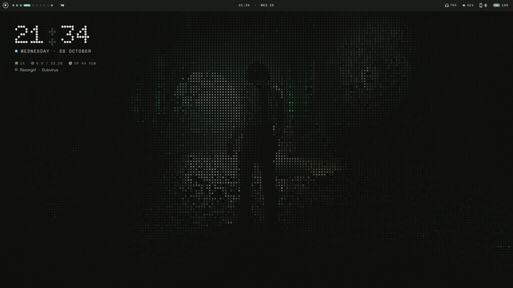
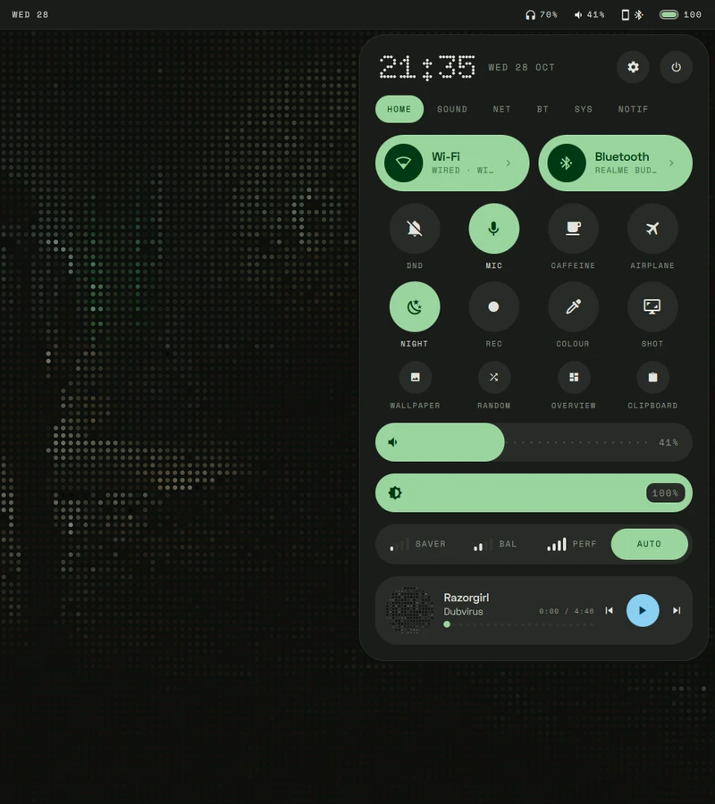
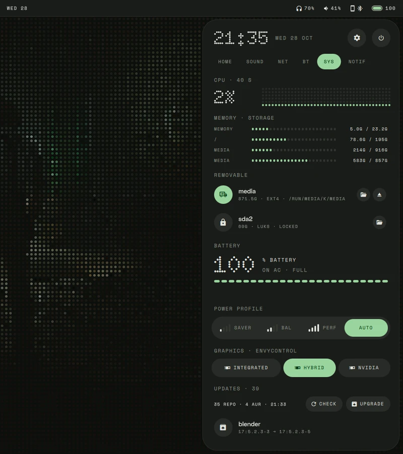
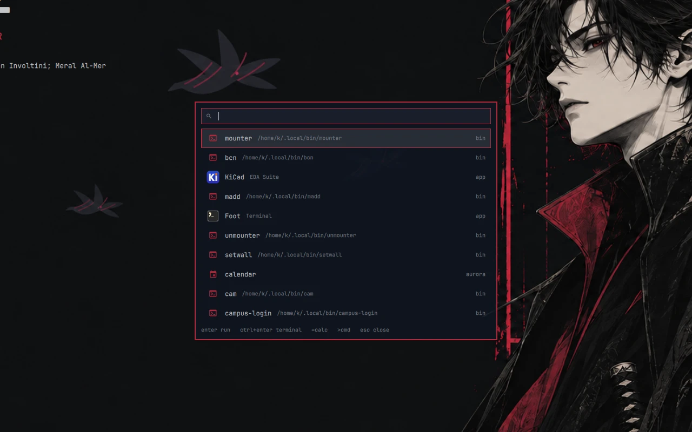
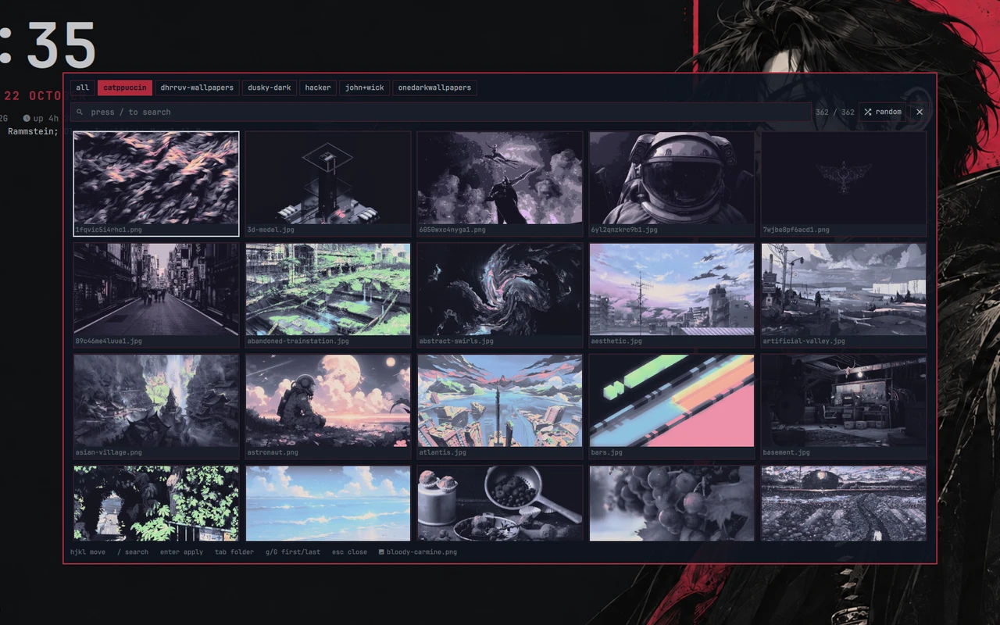
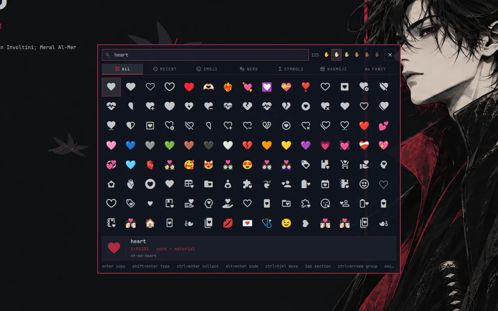
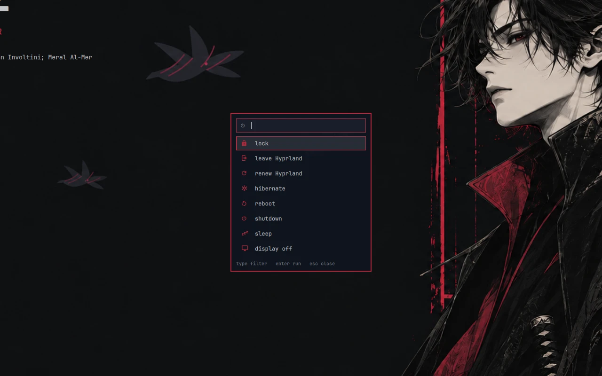
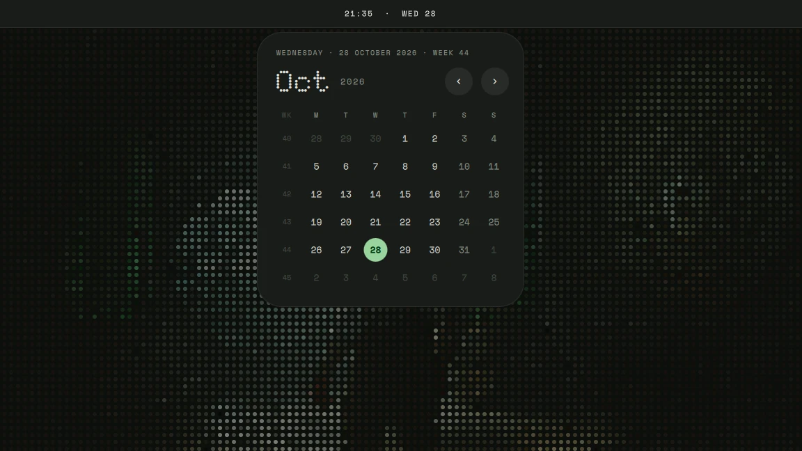
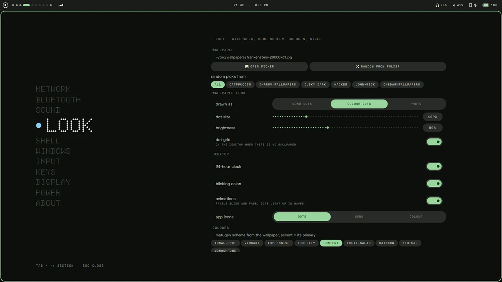
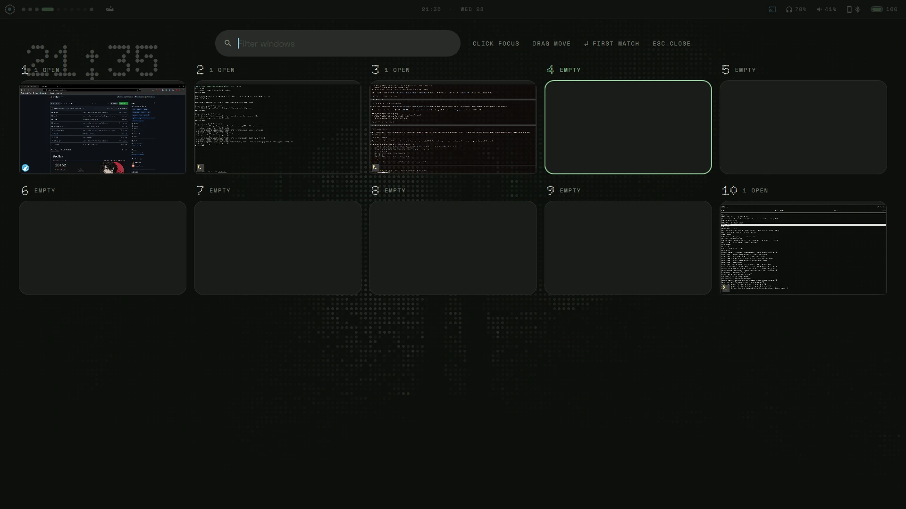

# Dotfiles



My desktop: **Arch Linux + Hyprland** (Lua config) + **aurora**, a custom Quickshell shell (bar, panel,
notifications, OSD, dock), themed live from the wallpaper with **matugen** and deployed with **GNU stow**.

## aurora
One shell instead of waybar, dunst, wlogout, fuzzel and a pile of scripts. Everything below is themed from the
current wallpaper.

<table>
  <tr>
    <td width="50%"><br>
      <sub><b>Control panel</b> · media, volume/mic/brightness, quick toggles, capture, session</sub></td>
    <td width="50%"><br>
      <sub><b>System</b> · cpu, memory, disks, battery, power profile, GPU mode (envycontrol)</sub></td>
  </tr>
  <tr>
    <td><br>
      <sub><b>Runner</b> (<kbd>Super</kbd>+<kbd>R</kbd>) · apps, scripts, calc, shell; also a dmenu for scripts</sub></td>
    <td><br>
      <sub><b>Wallpaper picker</b> · folders, search, re-themes everything through matugen</sub></td>
  </tr>
  <tr>
    <td><br>
      <sub><b>Glyph picker</b> (<kbd>Super</kbd>+<kbd>`</kbd>) · emoji, nerd icons, symbols, kaomoji, fancy text</sub></td>
    <td><br>
      <sub><b>Power menu</b> (<kbd>Super</kbd>+<kbd>Esc</kbd>) · lock, logout, suspend, reboot, ...</sub></td>
  </tr>
  <tr>
    <td><br>
      <sub><b>Calendar</b> · from the clock in the bar</sub></td>
    <td><br>
      <sub><b>Settings</b> (<kbd>Super</kbd>+<kbd>I</kbd>) · network, sound, appearance, Hyprland, keybinds, display, power</sub></td>
  </tr>
  <tr>
    <td colspan="2"><br>
      <sub><b>Overview</b> · live previews of every workspace and window, click to jump</sub></td>
  </tr>
</table>

> [!WARNING]
> **This is my personal setup, not a general purpose dotfiles framework.**
>
> It's built around my hardware (Lenovo Legion, Intel + NVIDIA hybrid graphics, `linux-zen`), my monitors,
> my keyboard and my habits. I'm not trying to make it work for everyone, and I won't be adding options
> or support for other setups. It's public as a **reference**, or for people who want **exactly the same
> setup** as me.
>
> **Only run `install.sh` on a freshly installed, unconfigured Arch Linux system.** It installs a lot of
> packages (NVIDIA drivers included if you pick them), replaces your configs with symlinks, changes your login
> shell and can enable system services. Don't run it on a system you already use.

## Installing (fresh Arch only)
```bash
git clone https://git.krolyxon.com/dotfiles ~/.dotfiles
cd ~/.dotfiles
./install.sh           # interactive: pick packages per group
./install.sh --yes     # pre-select the default packages, no pickers
./install.sh --check   # only compare installed packages with the lists, changes nothing
```
The repo has to live at `~/.dotfiles` (stow links into the parent directory).

## Packages
The lists live in `packages/*.txt`: one package per line, `#` for comments, and a trailing `!` means
"listed, but not pre-selected".

| file | |
|---|---|
| `desktop.txt` | always installed: Hyprland, Quickshell, PipeWire, the tools the shell and keybinds call |
| `utils.txt` | CLI tools, fonts, media, small utilities |
| `dev.txt` | development tools |
| `gpu.txt` | Intel + NVIDIA (`nvidia-open-dkms`) drivers. Change this for your hardware |
| `optional.txt` | desktop apps |
| `aur.txt` | AUR packages (installed with paru) |
| `base.txt` | reference only, never installed: what the base install already provides |

## What's inside
| | |
|---|---|
| WM | Hyprland (Lua config), hypridle, hyprlock; aurora draws the wallpaper (mono dots, colour dots or photo) |
| Shell / bar | aurora (Quickshell) |
| Theming | matugen: picking a wallpaper in aurora (or `setwall`) re-themes everything (GTK via adw-gtk3, Qt via qt6ct); accent = the wallpaper's own colour, near-black surfaces. The terminal (foot) too, with ANSI colours tinted toward the wallpaper |
| Terminal / shell | foot, zsh |
| Editor | Neovim (LazyVim) |
| Launcher / menus | aurora's runner (`aurora-run`, also a dmenu replacement for scripts) |
| Files | lf, pcmanfm |
| Music / video | mpd + ncmpcpp, mpv |
| Font / icons | Doto, Space Grotesk, Space Mono (shell UI, vendored in `.local/share/fonts/glyph`), JetBrainsMono Nerd Font, Papirus-Dark |

## Credits
- aurora's look follows Nothing OS via [glyph-rice](https://github.com/Nebelung-cloud/glyph-rice) by Nebelung-cloud
  (GPL-3.0): the design language, the dot-matrix shaders (`.config/quickshell/aurora/shaders/`) and several components
  are ported from it; ported files say so in their header. Nothing, Nothing OS and Glyph are trademarks of Nothing
  Technology Ltd; this is a fan setup, not affiliated with Nothing.
- Fonts in `.local/share/fonts/glyph/`: [Doto](https://github.com/oliverlalan/Doto),
  [Space Grotesk](https://github.com/floriankarsten/space-grotesk) and [Space Mono](https://github.com/googlefonts/spacemono),
  under the SIL Open Font License (`OFL.txt` next to them).
