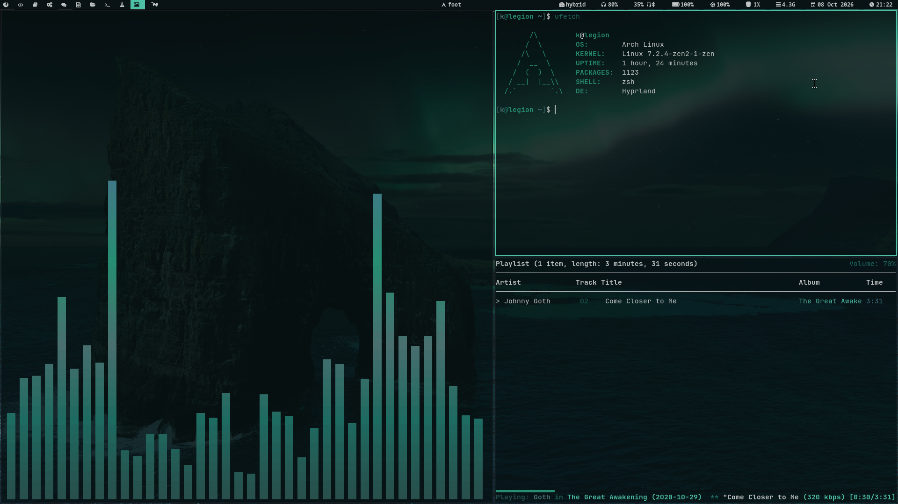

# Dotfiles



My desktop: **Arch Linux + Hyprland** (Lua config) + **aurora**, a custom Quickshell shell (bar, panel,
notifications, OSD, dock), themed live from the wallpaper with **pywal16** and deployed with **GNU stow**.

> [!WARNING]
> **This is my personal setup, not a general purpose dotfiles framework.**
>
> It's built around my hardware (Lenovo Legion, Intel + NVIDIA hybrid graphics, `linux-zen`), my monitors,
> my keyboard and my habits. I'm not trying to make it work for everyone, and I won't be adding options
> or support for other setups. It's public as a **reference**, or for people who want **exactly the same
> setup** as me.
>
> **Only run `install.sh` on a freshly installed, unconfigured Arch Linux system.** It installs a lot of
> packages (NVIDIA drivers included if you pick them), replaces your configs with symlinks, changes your login
> shell and can enable system services. Don't run it on a system you already use.

## Just want a piece of it?
You don't need the installer for that. Browse the repo and copy what you like, for example:
- `.config/quickshell/aurora/`: the shell (needs Quickshell; it reads its colours from `~/.cache/wal/colors.json`)
- `.config/hypr/`: Hyprland in the new Lua config format
- `.local/bin/`: small scripts (`setwall`, `brictl`, `sysact`, `tms`, ...)
- `.config/wal/templates/`: pywal16 templates for Hyprland, zathura, cava

## Installing (fresh Arch only)
```bash
git clone https://git.krolyxon.com/dotfiles ~/.dotfiles
cd ~/.dotfiles
./install.sh           # interactive: pick packages per group
./install.sh --yes     # pre-select the default packages, no pickers
./install.sh --check   # only compare installed packages with the lists, changes nothing
```
The repo has to live at `~/.dotfiles` (stow links into the parent directory).

What `install.sh` does:
1. Refuses to run as root or on anything other than Arch, and asks for confirmation if the system doesn't
   look fresh (another desktop's config, or lots of configs this repo doesn't provide).
2. Installs `stow gum git zsh`, shows the disclaimer, then lets you pick packages per group.
3. Runs `stow . --no-folding`. Files that are in the way are **moved** to `~/.dotfiles-backup/<date>/`, not deleted.
4. Sets zsh as your login shell.
5. Installs `paru` if it's missing, then installs the desktop packages and everything you picked.
6. Optionally copies `system/etc/keyd/default.conf` to `/etc/keyd` and enables `keyd` (capslock: tap esc, hold ctrl).

Afterwards, reboot and log in to Hyprland.

## Packages
The lists live in `packages/*.txt`: one package per line, `#` for comments, and a trailing `!` means
"listed, but not pre-selected".

| file | |
|---|---|
| `desktop.txt` | always installed: Hyprland, Quickshell, PipeWire, the tools the shell and keybinds call |
| `utils.txt` | CLI tools, fonts, media, small utilities |
| `dev.txt` | development tools |
| `gpu.txt` | Intel + NVIDIA (`nvidia-open-dkms`) drivers. Change this for your hardware |
| `optional.txt` | desktop apps |
| `aur.txt` | AUR packages (installed with paru) |
| `base.txt` | reference only, never installed: what the base install already provides |

## What's inside
| | |
|---|---|
| WM | Hyprland (Lua config), hypridle, hyprlock, hyprpaper |
| Shell / bar | aurora (Quickshell) |
| Theming | pywal16: picking a wallpaper in aurora (or `setwall`) re-themes everything |
| Terminal / shell | foot, zsh |
| Editor | Neovim (LazyVim) |
| Launcher / menus | aurora's runner (`aurora-run`, also a dmenu replacement for scripts) |
| Files | lf, pcmanfm |
| Music / video | mpd + ncmpcpp, mpv |
| Font / icons | JetBrainsMono Nerd Font, Yaru |
